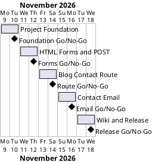

# Project Plan: 060 HTML Forms

## Metadata
| Key | Value |
| --- | --- |
| ID | PP-001 |
| CrossReference | [BC-001], [SA-001], [MIL-001], [MIL-002], [MIL-003], [MIL-004], [MIL-005] |
| Language | en |
| Domain | it |

## Version History
| Date | Status | Author | Reviewer | Change | Commit |
| --- | --- | --- | --- | --- | --- |
| 2026-11-09 | Deprecated | Jens Tirsvad Nielsen | S01 | Initial version | pending |
| 2026-11-09 | Accepted | Jens Tirsvad Nielsen | AI as stand-in for S01 | Accepted after Go review RC-003 | pending |

---

## Purpose

This plan schedules the five phases (gateways) that deliver the Day 60 repository, over the Business Case's constraints: one branch and pull request per milestone, finished within about ten days.

## Planning Assumptions

- The plan starts 2026-11-09 and ends by 2026-11-18.
- Phase length: one to two days per milestone, because the assignment is small.
- S01 is owner and reviewer of every gateway; in autonomous mode the AI acts as stand-in reviewer and each review record says "AI as stand-in for S01" ([SA-001]).
- Lecture steps used for screenshots: L1 serve index, L2 build the login form, L3 POST to /login, L4 receive_data, L5 blog with /form-entry, L6 print form data, L7 combined /contact route, L8 Jinja success message, L9 email with smtplib. Each has a screenshot in the README and the wiki.

## Gateway Schedule

| Gateway | Document | Window | Decision date | Owner | Stories | Main deliverable | Milestone |
| --- | --- | --- | --- | --- | --- | --- | --- |
| Project Foundation | [MIL-001] | 2026-11-09 to 2026-11-10 | 2026-11-10 | S01 | none (technical tasks) | A repository with `pyproject.toml`, `.gitignore`, `constants.py`, the `src/` and `tests/` layout, a Doxyfile, a README from the framework template with venv instructions, a Docker screenshot tool, and a description and topics on the git host. | not yet synced |
| HTML Forms and POST Requests | [MIL-002] | 2026-11-11 to 2026-11-12 | 2026-11-12 | S01 | none (technical tasks) | The html-forms demo: index page with `<h1>`, login form, `login` POST route and `receive_data`, tests, and a screenshot of each lecture step. | not yet synced |
| Blog Contact Route | [MIL-003] | 2026-11-13 to 2026-11-14 | 2026-11-14 | S01 | none (technical tasks) | The Bootstrap blog (home, about, post, contact), a `/form-entry` route, the combined `/contact` GET/POST route and the Jinja message, with tests and screenshots. | not yet synced |
| Contact Email | [MIL-004] | 2026-11-15 to 2026-11-16 | 2026-11-16 | S01 | none (technical tasks) | A `MailSender` port, an `smtplib` adapter configured from environment variables, the use case wired into `/contact`, tests that need no network, and a screenshot of the finished form. | not yet synced |
| Wiki and Release | [MIL-005] | 2026-11-17 to 2026-11-18 | 2026-11-18 | S01 | none (technical tasks) | A README with a screenshot for each lecture step, a wiki in English, Danish and Bahasa Malaysia explaining what was gained in each step, and a final verification run. | not yet synced |



## Scope Coverage

| Business Case scope item | Gateway |
| --- | --- |
| pyproject.toml, .gitignore, constants.py, Doxyfile, src/tests/docs, repository metadata | [MIL-001] |
| html-forms demo (index, login form, POST /login, receive_data) | [MIL-002] |
| Blog, /form-entry, combined /contact, Jinja message | [MIL-003] |
| Email with smtplib | [MIL-004] |
| README from template, screenshots, three-language wiki | [MIL-001], [MIL-005] |

## Dependencies

```
MIL-001 -> MIL-002 -> MIL-003 -> MIL-004 -> MIL-005
```

A No-Go on a gateway moves every later date by the rework time. S01 decides whether the end date 2026-11-18 moves, and records the reason in the Planning Assumptions.

## Plan Risks

| Risk | Impact | Mitigation |
| --- | --- | --- |
| The Gitea runner for continuous integration (CI) is missing | Rule 8 cannot be verified automatically | Run the same checks locally and report; stop and ask if CI cannot run |
| Udemy resources need the logged-in Chrome | Starting files may be unreachable | Rebuild from the lecture description and record it as a deviation |
| The AI produces the da and ms translations | Language quality risk | Keep sentences short; S01 can challenge them in the end-of-run summary |

## Open Issues

- Repository: `origin` is `Tirsvad-Udemy-100-days-of-code/060-html-forms`; the prompt names `Tirsvad-Udemy-100_days_of_code`. The plan uses `origin`; confirm at acceptance.
- Runtime dependencies: S03 asks for none, the assignment needs Flask; the plan uses Flask only ([SA-001] conflict table).
- The reviewer is S01 for every artifact because S02 and S03 are an audience, not reviewers.

---

[BC-001]: ./business-case.md
[SA-001]: ./stakeholder-analysis.md
[MIL-001]: ./milestones/mil-001-project-foundation.md
[MIL-002]: ./milestones/mil-002-html-forms-and-post.md
[MIL-003]: ./milestones/mil-003-blog-contact-route.md
[MIL-004]: ./milestones/mil-004-contact-email.md
[MIL-005]: ./milestones/mil-005-wiki-and-release.md
